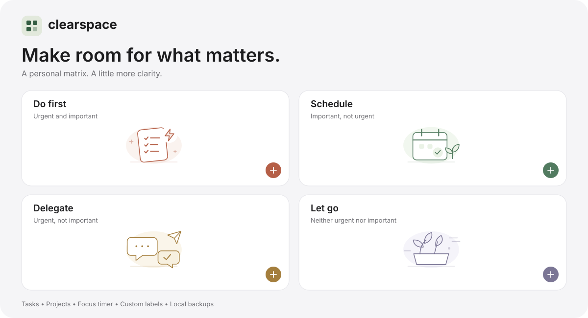

<p align="center">
  
</p>
<h1 align="center">Clearspace</h1>
<p align="center"><strong>Make room for what matters.</strong></p>
<p align="center">A personal Eisenhower Matrix for sorting tasks, organizing projects, and focusing on one thing at a time.</p>
<p align="center"><a href="https://clearspace-matrix.fastring19.chatgpt.site"><strong>Open Clearspace →</strong></a></p>



*Design overview using the project's own SVG artwork.*

## A calmer way to plan

Get tasks out of your head and give each one a place. Clearspace combines the four-quadrant matrix with projects, due dates, and a focus timer. It saves your work in your browser. A small server adapter adds protected, owner-only Dev controls while the regular app stays public.

| Quadrant | What belongs here | What to do |
| --- | --- | --- |
| Do first | Urgent and important | Take the next step now. |
| Schedule | Important, not urgent | Protect time for it. |
| Delegate | Urgent, not important | Ask for help or limit the effort. |
| Let go | Neither urgent nor important | Skip what adds little value. |

## What you can do

- **Manage tasks.** Create, edit, complete, delete, and move tasks between quadrants. Add notes, categories, projects, and optional due dates.
- **Organize projects.** Create and rename projects, filter their tasks, and delete a project without deleting its tasks.
- **Focus.** Choose a preset or custom session, then follow the remaining time in the header. Pause, resume, reset, or double-click the countdown to edit it.
- **Make it yours.** Customize quadrant titles, subtitles, and icons. Choose from 15 icons, switch to dark mode, and adjust text size from 90% to 160%.
- **See your progress.** Compact cards show active tasks, tasks due today, completed tasks, and completion percentage.
- **Recover and back up.** Undo task changes, export and import JSON backups, or reset the task matrix with confirmation. Notifications dismiss after 10 seconds.
- **Learn as you go.** A first-visit tutorial explains the matrix with examples. Replay it from Settings → Help.

The interface uses system typography, custom SVG illustrations, a translucent header, and responsive layouts. Motion respects reduced-motion preferences, with additional support for reduced transparency and increased contrast.

## Run locally

No dependency installation is needed. Node.js 20 or newer runs the local server, tests, and deployment build.

### Open the standalone file

Open [`standalone/clearspace.html`](standalone/clearspace.html) in a modern browser. The file contains its own favicon and works without a server. Browser support for persistent storage on `file:` URLs varies; use the local server below for a consistent origin.

### Serve the site

From the repository root, run:

```sh
npm start
# Or, without npm:
node scripts/serve.mjs
```

Open [127.0.0.1:8000](http://127.0.0.1:8000). The local server intentionally has no Dev authorization. Owner sign-in uses the hosted ChatGPT Sites integration.

## Owner-only Dev mode

**Owner-only Dev mode is deployed on the live site.**

Open [Clearspace Dev](https://clearspace-matrix.fastring19.chatgpt.site/dev) and sign in as the Site owner. A **Dev** button then appears in the header. Regular visitors do not see it and can keep using the public app without signing in.

- **Add 24 test tasks** creates six tasks per quadrant, three reusable test projects, varied dates and notes, and some completed tasks.
- **Remove test tasks** removes only tasks marked as Dev samples. Your own tasks and project definitions stay saved.
- Both actions support Undo and affect only the current browser.

The server authorizes Dev access using ChatGPT Sites identity headers and the secret `DEV_OWNER_EMAIL`. This email is configured in hosted environment settings, never embedded in the client or committed to the repository. Anonymous and other signed-in accounts are rejected.

## Everyday shortcuts

| Shortcut | Action |
| --- | --- |
| `N` | Add a task. |
| `P` | Add or manage projects. |
| Double-click the timer | Edit remaining time as minutes or `MM:SS`. |
| `Enter` while editing the timer | Save the new remaining time. |
| `Escape` while editing the timer | Cancel the edit. |

Task and project shortcuts are inactive while typing or while a dialog is open. Each quadrant also has its own **+** button. On a phone, use the task editor's quadrant selector to move a task.

## Your data

Tasks, projects, quadrant labels, appearance preferences, and tutorial dismissal are stored in `localStorage`. The app has no task database, analytics service, or third-party runtime scripts. The server only serves the app, authorizes Dev access, and returns sample task data; it does not store visitor tasks.

- Every browser and site origin has its own data. Local files, localhost, and the hosted site do not share storage.
- Tasks do not sync across devices or people. Sharing the website shares the tool, not your tasks.
- Clearing browser data removes saved work. Export backups regularly.
- JSON backups include tasks and projects. They do not include label, appearance, or timer settings.
- Import merges tasks by ID and supports older task-only backups.
- Focus sessions run in the current page. Reloading or closing the page stops the session.

## Project structure

```text
clearspace-matrix/
├── app/
│   ├── index.html          # App markup, styles, and browser JavaScript
│   └── favicon.svg
├── worker/
│   └── handler.mjs         # Public routes and owner-only Dev endpoints
├── scripts/
│   ├── build.mjs           # Packages app and adapter into a single Worker
│   ├── serve.mjs           # Local anonymous preview server
│   └── validate-artifact.mjs
├── standalone/clearspace.html
├── tests/
│   ├── smoke.cjs           # Browser-state checks with a mock DOM
│   ├── dev-client.cjs      # Generation, cleanup, and Undo checks
│   └── dev-server.mjs      # Authorization and endpoint tests
├── docs/
├── .openai/hosting.json
├── .env.example            # Secret key name, without a value
└── package.json
```

## Validation

With Node.js 20 or newer:

```sh
npm test
# Or, without npm:
node tests/smoke.cjs
node --test tests/dev-server.mjs
node tests/dev-client.cjs
```

The checks exercise task changes, Undo, projects, import compatibility, custom labels and icons, settings, tutorial navigation, focus controls, direct countdown editing, and matrix reset. The server suite also checks owner authorization, anonymous public access, sign-in routing, CSRF checks, and sample data. The client checks use a small mock DOM, so they do not verify browser layout, native drag-and-drop, real-time countdown accuracy, or device accessibility. Visual browser testing remains a separate check.

## Hosting

[The live site](https://clearspace-matrix.fastring19.chatgpt.site) is public and hosted through ChatGPT Sites. The browser app can be served statically from `app/`, without Dev authorization. The protected Dev feature requires the server adapter and trusted platform identity. This repository does not automatically deploy on push.

See [deployment notes](docs/deployment.md) before changing the existing hosted page.
