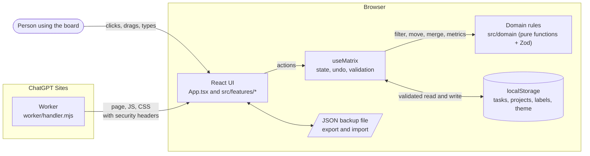
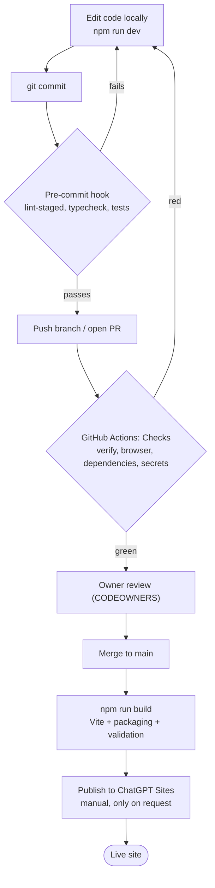

# Clearspace at a glance

A one-page orientation for anyone new to this repository. It explains what the app does, what it is built with, how the pieces fit together, and what runs on every change. For detail, follow the links to the [README](../README.md), [architecture notes](architecture.md), and [deployment notes](deployment.md).

## What it is

Clearspace is a personal [Eisenhower Matrix](https://en.wikipedia.org/wiki/Time_management#The_Eisenhower_Method): a to-do board split into four quadrants by urgency and importance.

| Quadrant | Meaning                      |
| -------- | ---------------------------- |
| Do first | Urgent and important         |
| Schedule | Important, not urgent        |
| Delegate | Urgent, not important        |
| Let go   | Neither urgent nor important |

People add tasks (with notes, subtasks, due dates, categories and projects), drag them between quadrants, filter by status or project, and complete them. Everything is saved in the browser's `localStorage`. There are no accounts, no database and no sync: each browser keeps its own board, and JSON export/import is the backup.

The live site is [clearspace-matrix.fastring19.chatgpt.site](https://clearspace-matrix.fastring19.chatgpt.site), hosted on ChatGPT Sites. Deployment is manual and only happens when explicitly requested.

## Tech stack

| Area           | Tools                                                                                  |
| -------------- | -------------------------------------------------------------------------------------- |
| Language       | TypeScript (strict mode)                                                               |
| UI             | React 19, Base UI (selects and dropdowns), Heroicons, Motion (animations)              |
| Data and rules | Zod schemas for every stored, imported or served shape; pure domain functions          |
| Build          | Vite 8, plus Node scripts that package the app into a single Worker file               |
| Hosting        | A small Worker (`worker/handler.mjs`) on ChatGPT Sites that serves the page and assets |
| Unit tests     | Vitest, React Testing Library, jsdom; Node's built-in test runner for the Worker       |
| Browser tests  | Playwright (Chromium, desktop and phone viewports), axe-core for accessibility scans   |
| Code quality   | ESLint 9 (React, Hooks, JSX a11y, typed rules), Prettier, Husky and lint-staged hooks  |
| CI             | GitHub Actions (`.github/workflows/checks.yml`), Gitleaks, `npm audit`, Dependabot     |
| Runtime        | Node.js 22.12 or newer locally, Node.js 24 in CI                                       |

## How it works

The whole app runs in the browser. The server never sees task data; it only hands out the compiled page.



In words:

1. The Worker serves one HTML page plus hashed JS and CSS files, with caching and a strict Content-Security-Policy. It has no API and stores nothing.
2. React renders the board. Feature folders under `src/features/` own each area: tasks and the matrix board, projects, settings and labels, backup, tutorial, the (currently hidden) focus timer, and local-only Dev tools.
3. Every change goes through the `useMatrix` hook. It calls pure functions in `src/domain/` to compute the next board, validates it with Zod, keeps one step of Undo, and writes it to `localStorage`.
4. On load, saved data is read and validated. Unreadable data is left untouched so it can still be exported. Changes in another tab are picked up through storage events.

## Repository map

| Path                 | What lives there                                                          |
| -------------------- | ------------------------------------------------------------------------- |
| `src/App.tsx`        | Screen composition and cross-feature actions                              |
| `src/features/`      | One folder per feature (tasks, projects, settings, backup, tutorial, ...) |
| `src/domain/`        | Typed models, Zod schemas and pure matrix operations                      |
| `src/lib/`           | Hooks for state, preferences, motion, toasts and dates                    |
| `src/components/`    | Shared dialogs, popovers, selects, icons and illustrations                |
| `src/styles.css`     | All styling, themes and responsive layout                                 |
| `worker/handler.mjs` | The production server                                                     |
| `scripts/`           | Packaging, bundle-size budget, artifact validation, local preview server  |
| `tests/worker.mjs`   | Server tests                                                              |
| `e2e/`               | Playwright browser tests                                                  |
| `.github/`           | CI workflow, Dependabot, CODEOWNERS and the PR template                   |

Unit tests sit next to the code they cover as `*.test.ts(x)`.

## From code change to live site



### The build

`npm run build` runs these steps in order, and any failure stops it:

1. `tsc --noEmit` type-checks the project.
2. `vite build` compiles the React app into `client-dist/`.
3. `scripts/check-size.mjs` fails if the JavaScript exceeds 200 kB gzipped.
4. `scripts/build.mjs` packages the page, assets and Worker into `dist/server/index.js`.
5. `scripts/validate-artifact.mjs` checks the output and confirms Dev tools and sample data are absent from production.

Preview the result locally with `npm run serve:worker` at http://127.0.0.1:8000.

## Tests

| Suite            | Command            | What it covers                                                                                                                                                                                   |
| ---------------- | ------------------ | ------------------------------------------------------------------------------------------------------------------------------------------------------------------------------------------------ |
| React and domain | `npm test`         | Vitest + Testing Library on real components: the board and layout, task editor, subtasks, due dates, projects, reset, backup, preferences, undo, storage compatibility, Dev samples, focus timer |
| Worker           | `npm test`         | `tests/worker.mjs` with Node's test runner: public routes, headers, and that old `/dev` routes return 404                                                                                        |
| Browser (E2E)    | `npm run test:e2e` | Playwright against the production build in desktop (1280×900) and phone (390×844) viewports: tasks, projects, filters, settings, backup, cross-tab sync, hardening, UX                           |
| Accessibility    | `npm run test:e2e` | `e2e/a11y.spec.ts` runs axe-core and reports violations without failing the run                                                                                                                  |
| Visual baselines | manual             | `e2e/screenshots.spec.ts` captures full-page screenshots only when `SHOTS_DIR` is set                                                                                                            |

`npm run check` runs formatting, lint, typecheck, unit tests and the build in one go. Run it before pushing.

## CI/CD

**Pre-commit (local).** Husky runs on every `git commit`: lint-staged formats and lints staged files, then the full typecheck and `npm test` run. A failure blocks the commit.

**GitHub Actions.** One workflow, [Checks](../.github/workflows/checks.yml), runs on every push and on pull requests (opened, updated, reopened, or marked ready). It has four parallel jobs on Ubuntu with Node 24:

| Job            | What it does                                                                   |
| -------------- | ------------------------------------------------------------------------------ |
| `verify`       | `npm ci`, Prettier check, typecheck, ESLint (zero warnings), `npm test`, build |
| `browser`      | Installs Chromium and runs the Playwright suite (`npm run test:e2e`)           |
| `dependencies` | `npm audit`, failing on high or critical vulnerabilities                       |
| `secrets`      | Gitleaks scans the full Git history for committed credentials                  |

The workflow has read-only permissions, per-job timeouts, actions pinned to commit hashes, and cancels older runs when a branch gets a new push.

**Dependabot** opens weekly update PRs for npm packages and GitHub Actions.

**Deployment** is not automated. Nothing deploys on push or merge; publishing to ChatGPT Sites is a manual step done only when asked. See [deployment notes](deployment.md).

## Getting started

```sh
npm ci          # install dependencies and the pre-commit hook
npm run dev     # start the app at the printed localhost URL
```

A **Dev** button appears in the header during local development. It adds or removes 24 sample tasks so you have something to look at. It never ships to production.

Next reads: the [README](../README.md) for features and phone testing, [architecture notes](architecture.md) for state and storage details, [CONTRIBUTING](../CONTRIBUTING.md) for the PR workflow, and [SECURITY](../SECURITY.md) before publishing a fork.
