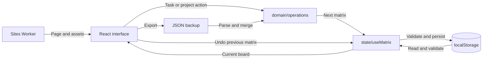
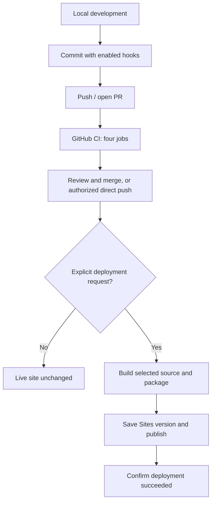

# Clearspace at a glance

Clearspace is a browser-local task planner built around the Eisenhower Matrix. This guide explains the product, data flow, development tools and delivery process. See the [README](../README.md) for setup details, [architecture](architecture.md) for implementation details and [deployment](deployment.md) for publishing.

## What the app does

| Quadrant | Meaning                      |
| -------- | ---------------------------- |
| Do first | Urgent and important         |
| Schedule | Important, not urgent        |
| Delegate | Urgent, not important        |
| Let go   | Neither urgent nor important |

Tasks support notes, subtasks, due dates, categories and optional projects. Users can edit, complete, delete, search, filter and reorder tasks. Desktop drag-and-drop moves tasks between quadrants; phones use the editor's quadrant picker. Subtask completion is independent of its parent. Due dates display as MM/DD/YYYY and remain ISO dates in storage.

One quiet top bar holds today's date and progress, the Active / Completed / All tasks tabs, and icon buttons for search, filters, projects and Settings. The four quadrants share the rest of the screen equally, and only their task lists scroll. Phones put the tabs on a second row.

On an empty board, the top bar offers Add task and Examples in place of progress. Each quadrant's + button appears once a task exists. Cancelling the editor leaves the board empty; clearing every task brings the starter buttons back. Filtered-empty views keep the add controls. N opens a new task and P opens projects.

Settings offers Light (the default), Dark and Auto appearance, text sizes from 90% to 160%, quadrant labels and icons, Help, Export and Import, Clear completed and a guarded board reset. The seven-step tutorial shows progress as dots; on a board that is still empty, its last step offers example tasks.

## Tech stack

| Area              | Tools                                                                     |
| ----------------- | ------------------------------------------------------------------------- |
| App               | React 19, strict TypeScript, Vite 8                                       |
| Interface         | CSS (sketchbook theme), Base UI selects, Heroicons, Motion                |
| State and data    | React hooks/reducer, pure domain functions, Zod, localStorage             |
| Production server | Worker serving the page, favicon and hashed assets                        |
| Tests             | Vitest, Testing Library, Node test runner, Playwright, axe-core           |
| Quality and CI    | ESLint, Prettier, Husky, lint-staged, GitHub Actions, Gitleaks, npm audit |
| Runtime           | Node 22.12 or newer locally; Node 24 in CI                                |

## How data moves



The Worker supplies the app without receiving task data. React reads saved state, validates it and displays the board. Every task or project action is a pure function in `domain/operations.ts` that returns a new matrix; `useMatrix` validates it, keeps one previous snapshot for Undo and saves it in an effect. Search, filters and progress are derived on render by `domain/queries.ts`. Labels, theme and text size live in `usePreferences`.

Tasks, projects and preferences stay in the current browser and origin. There is no account system, task database or cross-device sync. Tabs on the same origin receive matrix updates through storage events. Incoming updates wait while a dialog is open; a later local save takes precedence.

Backups contain tasks, subtasks and projects, excluding appearance settings. Import merges compatible data. Unreadable saved data is preserved and can be exported for recovery while edits remain in memory. Reset requires typing `Reset`, clears tasks/projects, retains appearance/labels and supports Undo.

## Finding your way around

| Path              | Responsibility                                                         |
| ----------------- | ---------------------------------------------------------------------- |
| `src/app/`        | `App.tsx` composition root, top bar, shortcuts and crash recovery      |
| `src/features/`   | Tasks, filters, projects, settings, backups, tutorial and Dev tools    |
| `src/domain/`     | Types, validation and pure board operations, queries and serialization |
| `src/state/`      | Board, preferences and toast hooks, plus every localStorage key        |
| `src/components/` | Shared dialogs, popovers, selects, icons and illustrations             |
| `src/lib/`        | Browser helpers: IDs, motion, dates, downloads                         |
| `src/styles/`     | Global CSS in cascade order, ending with the sketchbook theme          |
| `worker/`         | Public server: page, assets, caching and security headers              |
| `scripts/`        | Packaging, size budget, artifact checks and local preview              |
| `e2e/`, `tests/`  | Browser and Worker tests; unit and component tests sit beside source   |
| `.github/`        | Workflow, Dependabot, CODEOWNERS and PR template                       |

The [architecture notes](architecture.md) draw these layers and follow one change from a click to storage.

```sh
npm ci                # dependencies and hook installation
npm run dev           # local Vite server
npm run dev:mobile    # same-network phone access
npm run build         # production packaging
npm run serve:worker  # production preview at 127.0.0.1:8000
```

The local Dev button adds 24 samples across all quadrants and categories. A random 12 tasks receive two to four subtasks. Cleanup removes marked samples. Production excludes these controls and has no `/dev` mode. Different origins and phones have separate storage.

## Tests and delivery



Pushes run CI; they do not deploy. Normal changes use PR review, while authorized direct pushes also run checks. Publishing separately selects and packages the requested source, saves a Sites version and verifies the result.

| Check          | Coverage                                                                                                          |
| -------------- | ----------------------------------------------------------------------------------------------------------------- |
| `verify`       | Prettier, TypeScript, React/Hooks/accessibility ESLint, component/domain tests, Worker tests and production build |
| `browser`      | Playwright Chromium desktop and simulated mobile interactions/layouts                                             |
| `dependencies` | npm audit fails on high/critical vulnerabilities                                                                  |
| `secrets`      | Gitleaks scans Git history with values redacted                                                                   |

`npm test` runs Vitest/Testing Library and Worker tests. `npm run test:e2e` runs browser checks. `npm run check` combines formatting, lint, types, tests and build. The current owner workflow leaves tests to GitHub CI. Enabled Husky hooks format/lint staged files and run types/tests; CI checks independently.

Builds produce `client-dist/`, enforce the JavaScript gzip budget and package `dist/server/index.js`. Hashed JS/CSS remain separate browser requests served by the Worker, with immutable caching; HTML revalidates through an ETag. Artifact checks confirm production excludes Dev tools.

Axe scans report findings without failing CI. Optional screenshots capture images rather than asserting visual baselines. Simulated phones do not replace hardware, screen-reader or motion review. Super-Linter is not installed. CODEOWNERS identifies the owner but does not itself block pushes or merges. Dependabot proposes weekly dependency/action updates.

The [release timeline](RELEASE_HISTORY.md) and [source mapping](release-history.json) record each successful deployment, including labeled reconstructions for the initial retrospective history. The archive branch is historical, not the current app. More detail lives in [CONTRIBUTING](../CONTRIBUTING.md), [SECURITY](../SECURITY.md) and the [deployment guide](deployment.md).
