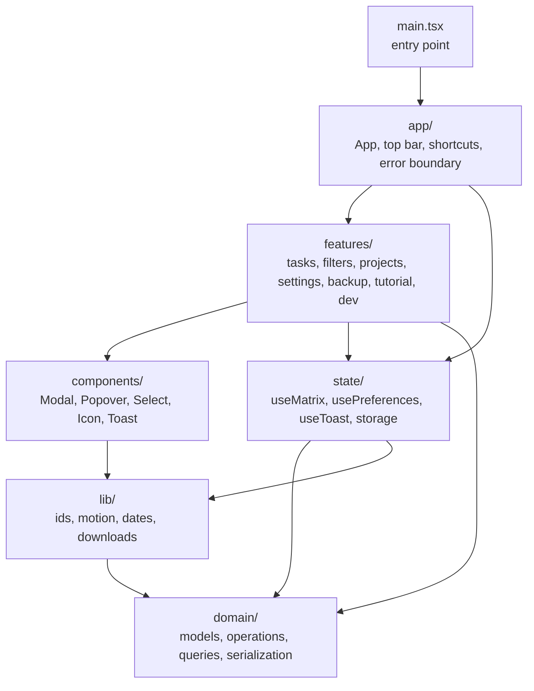
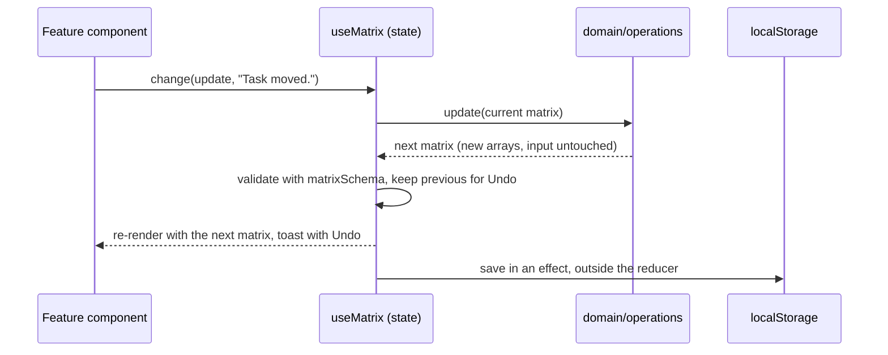

# How Clearspace works

Clearspace is a React 19 and TypeScript app built with Vite. Everything a person types stays in their own browser: the app reads and writes `localStorage`, and a small Worker only serves the built page and its assets. There is no account, database or API.

This page walks through the code from the outside in. For a one-page tour of the product, tech stack and delivery, start with the [overview](OVERVIEW.md).

## The layers

The source is arranged so that each folder has one job and imports only point downward: the screen depends on features, features depend on state and shared components, and everything rests on the pure `domain/` layer, which depends on nothing but Zod.

| Folder            | Responsibility                                                                                                                                                                                                                                                                                                |
| ----------------- | ------------------------------------------------------------------------------------------------------------------------------------------------------------------------------------------------------------------------------------------------------------------------------------------------------------- |
| `src/main.tsx`    | Mounts React inside the crash `ErrorBoundary` and `MotionProvider` and loads `styles/index.css`.                                                                                                                                                                                                              |
| `src/app/`        | `App.tsx` owns screen state (which dialog is open, which task is being edited) and wires state hooks to features. `AppHeader` arranges the top bar. `useBoardActions` and `useKeyboardShortcuts` keep App free of inline logic. `ErrorBoundary` replaces a crashed screen with a way to download saved tasks. |
| `src/domain/`     | The rules of the board, as pure functions with no React or browser APIs. `models.ts` (Zod schemas and types), `operations.ts` (every change), `queries.ts` (what each quadrant shows, progress), `serialization.ts` (saved format, backups, merge), `dates.ts`.                                               |
| `src/state/`      | React hooks that own long-lived state. `useMatrix` holds the board, `usePreferences` holds labels, theme and text size, `useToast` holds the one notification. `storage.ts` lists every `localStorage` key.                                                                                                   |
| `src/features/`   | One folder per area of the product: `tasks` (board, cards, editor), `filters` (search, filters, status tabs), `projects`, `settings` (menu, labels, backups, reset), `backup`, `tutorial`, and `dev` (local-only sample data).                                                                                |
| `src/components/` | Shared UI building blocks: native-dialog `Modal`, `Popover`, Base UI `Select`, Heroicons `Icon`, `Toast` and illustrations.                                                                                                                                                                                   |
| `src/lib/`        | Small browser helpers: UUIDs that work over plain HTTP, the motion context, `useToday` (rolls over at midnight), header measuring, file downloads and a dialog-closed event.                                                                                                                                  |
| `src/styles/`     | Global CSS in cascade order (see [Styles](#styles)).                                                                                                                                                                                                                                                          |
| `worker/`         | `handler.mjs` serves the page, favicon and hashed assets with caching and security headers.                                                                                                                                                                                                                   |

## How a change flows

Every edit, from checking a box to importing a backup, takes the same path.

1. A component calls `change(update, message)`. `update` is a pure function from `domain/operations.ts`, such as `moveTask` or `toggleSubtask`.
2. `useMatrix` runs it against the current matrix and validates the result with Zod. An invalid result is rejected with a message and nothing changes.
3. The reducer stores the new matrix and keeps the previous one, so Undo restores tasks and projects together, once.
4. An effect writes the new matrix to `localStorage`. A failed write shows a warning; edits stay in memory.

Everything else on screen is derived on render: `queries.ts` decides which tasks each quadrant shows for the current tab, search, filters and sort, and `stats` computes the progress ring.

## The screen

The top bar holds, from left to right, the logo with today's date and progress (`DayPanel`), the Active / Completed / All tasks tabs, and icon tools for search, filters, projects, the Dev panel (development only) and Settings. Below it, the four quadrants share the viewport equally, with "urgent / not urgent" across the top and "important / not important" down the side. Only the task lists scroll. Phones keep the date, progress and tools on one row and put the tabs on a second row.

On an empty board, Add task and Examples take the place of progress in the top bar, and each quadrant shows its illustration and a short prompt. Each quadrant's + button appears once the board has a task, with a short reveal that is skipped for keyboard input and reduced motion. (A floating quick-add button is still rendered, but the current layout keeps it hidden at every width.) Cancelling the editor does not reveal them; clearing the last task hides them again. Filtered-empty views keep them.

Dragging a card on desktop lifts a tilted copy and marks the insertion point; the first drag also carries a "drag it to another quadrant" note. Phones move tasks with the editor's quadrant picker. Completing the last active task in a quadrant plays a short check-and-sparkle celebration.

Settings is a popover with Edit labels, Help, the GitHub link, Appearance (Auto, Light, Dark), Text size (90% to 160%), Backups & data (Export and Import, with the last backup date), and a Danger zone (Clear completed, and Need a fresh start? to reset the board).

The seven-step Getting Started tutorial opens on a first visit and from Settings → Help. Dots show progress, and screen readers hear "Step N of 7". Back appears from the second step. On the last step, an empty board offers Start with example tasks or Use my own tasks; a board that already has tasks just shows Got it.

Shared dialogs use native `<dialog>` elements; popovers close on outside click and Escape. Motion shared layouts animate task moves and reflow, and presence boundaries animate additions, filtering and removals. Outgoing cards, popovers, dialogs and toasts become inert and hidden from assistive technology during their short exits. `MotionProvider` tracks input modality and reduced-motion, keeping keyboard actions immediate.

## Data model

Zod schemas in `domain/models.ts` define the TypeScript types and validate every mutation, every read from storage and every imported backup.

- **Task:** title, quadrant, notes, category, optional project, optional ISO `YYYY-MM-DD` due date (shown as `MM/DD/YYYY`), completion time, and optional subtasks. Checking every subtask does not complete the parent.
- **Project:** an ID and a unique (case-insensitive) name. Tasks reference project IDs, so renaming a project updates every task.
- **Labels:** each quadrant's title, subtitle and icon.

IDs stay stable through edits and moves. In All tasks, active tasks come first and a newly completed task moves to the bottom of its quadrant.

## Persistence and compatibility

All keys are defined in `state/storage.ts`. Their names are part of the saved format and must not change.

| Key                        | Contents                                                        |
| -------------------------- | --------------------------------------------------------------- |
| `clearspace.matrix.v1`     | Version-2 tasks and projects. Legacy task arrays are accepted.  |
| `clearspace.labels.v1`     | Quadrant titles, subtitles and icons.                           |
| `clearspace.theme`         | `auto`, `light` or `night`. Missing means Auto (follow the OS). |
| `clearspace.fontSize.v1`   | Text-size percentage, 90 to 160.                                |
| `clearspace.tutorial.v1`   | Set once the tutorial has been seen.                            |
| `clearspace.lastBackup.v1` | Timestamp of the last exported backup.                          |
| `clearspace.dragHint.v1`   | Set once the first-drag hint has been shown.                    |

Older stock subtitles are upgraded to today's wording; custom labels are kept. Legacy owner fields are preserved. Version-1 (tasks only) and version-2 (tasks and projects) backups both import.

If saved data cannot be read, it is left untouched and edits stay in memory. Export then hands back the original unreadable text as a recovery file. Backups contain tasks, subtasks and projects, not labels or appearance.

Import merges tasks by ID and treats projects with the same name (ignoring case) as one. Deleting a project asks for confirmation with its task count and up to two titles, then removes the project and its tasks. Reset requires typing `Reset` exactly, clears tasks and projects, and keeps labels and appearance. Both support Undo. Toasts dismiss after ten seconds; hovering or focusing one pauses the timer.

Storage events keep tabs on the same origin in step. While a dialog is open, an incoming update waits until it closes; if this tab saved in the meantime, its newer state wins. This is same-browser tab sync, not cloud sync: different browsers, devices and origins keep separate boards.

## Local Dev tools

`App.tsx` imports the Dev panel only when Vite's compile-time `import.meta.env.DEV` flag is set, so production builds contain neither the panel nor the sample generator, and no URL or storage value can turn them on.

The generator returns 24 tasks marked `isDevSample: true` across all quadrants and the Work, Personal, Health and Learning categories, plus Dev projects. A random 12 receive two to four subtasks. Cleanup removes only marked tasks. Both use the normal `change` path, so Undo works. The old `/dev` and `/api/dev/*` routes return 404.

## Styles

`styles/index.css` imports the stylesheets in cascade order. Later files refine earlier ones, so the order matters.

| File                 | Contents                                                           |
| -------------------- | ------------------------------------------------------------------ |
| `01-base.css`        | Design tokens, resets, typography, focus rings                     |
| `02-layout.css`      | Page shell, top bar, buttons, menus, tabs, search                  |
| `03-board.css`       | Axis labels, quadrants, task cards, checkboxes, add buttons        |
| `04-dialogs.css`     | Editor, projects, labels, settings menu, tutorial, toast           |
| `05-dark-mode.css`   | Dark theme colors (`.night` on `<html>` and `<body>`)              |
| `06-responsive.css`  | Hover states, entry animations, breakpoints, accessibility prefs   |
| `07-interaction.css` | Keyboard vs pointer, custom selects, motion, dialog exits, touch   |
| `08-controls.css`    | Tabs, first-task prompt, chips, filters panel, subtasks, due date  |
| `09-day-bar.css`     | Date and progress summary                                          |
| `10-viewport.css`    | The viewport owns the board size; only task lists scroll           |
| `11-top-bar.css`     | The one quiet top bar                                              |
| `sketchbook.css`     | The sketchbook theme: ink outlines, lined paper, tape, handwriting |

The sketchbook theme uses self-hosted Archivo and Caveat subsets from `src/assets/fonts/`. Text size scales through the `--text-scale` custom property that `usePreferences` sets.

## Build outputs

Vite compiles the app into `client-dist/`. `scripts/build.mjs` embeds the page, favicon and hashed JavaScript and CSS into the Worker bundle `dist/server/index.js`; assets stay separate requests rather than being inlined. Hashed assets are cached for a year, and the page revalidates with an ETag. The inline pre-paint theme script is allowed by its CSP hash. `npm run serve:worker` previews that exact bundle. `scripts/check-size.mjs` enforces a 200 kB gzipped JavaScript budget, and `scripts/validate-artifact.mjs` confirms Dev tools and sample data are absent.

## Tests

Unit and component tests sit beside the code they cover (Vitest and Testing Library); Worker tests live in `tests/` (Node's test runner); browser tests live in `e2e/` (Playwright, desktop and simulated phone). Domain tests are split like the domain itself: `operations`, `queries`, `serialization` and `subtasks`. A few component tests load the real base stylesheets through `src/test/readBaseStyles.ts`.

CI has four jobs: code and build verification, browser tests, dependency audit and secret scanning. Axe scans report findings without failing the suite, and screenshot capture (`SHOTS_DIR=… npx playwright test e2e/screenshots.spec.ts`) is opt-in rather than an automatic visual diff. Automated checks do not replace a real-device or screen-reader review.

During a modal exit, the native dialog closes and the element becomes inert before Motion removes it. A browser test that needs complete removal should check the DOM element, not only its accessible role.

See the [overview](OVERVIEW.md), [deployment notes](deployment.md) and [release history](RELEASE_HISTORY.md) for orientation, publishing and past changes.
